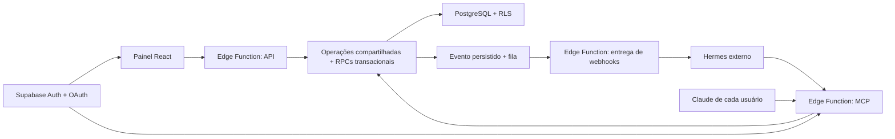

# Plataforma de tarefas para agentes externos

Data: 2026-10-20. Estado: revisão técnica independente concluída; escopo completo
aprovado pelo usuário para implementação por etapas.

## Objetivo e decisões confirmadas

Agentes são os usuários principais. Humanos usam o painel para acompanhar trabalho,
alterar prioridades e intervir. Hermes e os Claudes dos usuários executam fora deste
produto. O sistema coordena tarefas e registra resultados; não hospeda modelos ou
processos de agentes.

Stack aprovada na conversa: React + TypeScript + Vite + shadcn/ui no painel;
Supabase PostgreSQL, Auth e Edge Functions no backend. MCP remoto permite consultar
e alterar o trabalho. Webhooks avisam o Hermes sobre eventos. Não haverá servidor
Node separado nem TanStack Start nesta migração.

O aceite da arquitetura não é uma afirmação de que as integrações já existem.
Este documento transforma essas escolhas no escopo concreto da migração.

## Estado encontrado e preservação

- Base inspecionada: commit `d0c1557`, branch `main`, árvore limpa.
- `src/main.js` inicia módulos JavaScript; `src/shell/render.js` substitui HTML.
  Há 22 rotas em `src/shell/layout.js`, oito abas de projeto e rotas de autenticação.
- `src/styles/tokens.css` e `src/core/design-tokens.js` definem o visual, os temas,
  os acentos e a densidade. PT-BR é o idioma padrão; inglês também é suportado.
- Supabase tem `workspaces`, `workspace_memberships` e `workspace_snapshots`.
  Projetos, tarefas e relações ficam num JSON com uma revisão por workspace.
- IDs legados de tarefas/projetos são texto, como `t1` e `p1`. Não converter
  implicitamente esses IDs para UUID nem usar a chave humana como identidade.
- `docs/adr/0001-workspace-storage.md` continua descrevendo a implementação atual;
  o modelo deste documento só a substitui após migração e validação.
- A demonstração local e os dados existentes devem continuar acessíveis.
  Dados locais não serão enviados automaticamente para uma conta cloud.

## Arquitetura proposta

API e MCP validam entradas e chamam as mesmas operações. A autorização, a revisão
do registro, a reserva de tarefa, a autoria e os eventos são garantidos no banco,
inclusive para chamadas diretas a PostgREST/RPC. Ocultar um botão não concede nem
retira uma permissão. O código compartilhado de Edge Functions fica em
`supabase/functions/_shared/`; contratos de domínio ficam em `src/domain/`.

## Modelo de dados

Manter workspaces e memberships como autoridade de identidade e acesso. Introduzir
tabelas para projetos, tarefas, subtarefas, dependências, labels, comentários e
reações, equipes e seus membros, metadados de arquivos, eventos de calendário,
views salvas, preferências pessoais e histórico de atividade. Campos existentes
precisam de mapeamento explícito; campos legados não modelados permanecem num
`legacy_metadata` validado, sem controlar autorização.

As entidades legadas mantêm `id text` com chave composta `(workspace_id, id)`.
Novos IDs são gerados pelo servidor com UUID serializado como texto. Relações usam
FKs compostas com workspace, impedindo referências entre organizações. Assignees
humanos referenciam memberships reais; agentes referenciam registros próprios.
Uma tarefa pode ter um responsável humano e um agente executor, sem converter um
agente em membro humano fictício.

Tarefas preservam estados `backlog`, `todo`, `progress`, `review`, `done` e prioridades
`none`, `low`, `medium`, `high`, `urgent`. Bloqueio é um motivo estruturado da execução,
não uma substituição silenciosa desses estados. Sequências de chaves por projeto,
recorrência e operações em lote precisam ser atômicas.

Adicionar `agents`, `agent_connections`, `task_claims`, `task_runs`,
`integration_grants`, `idempotency_requests`, `domain_events`,
`webhook_subscriptions` e `webhook_deliveries`. Os nomes finais das tabelas auxiliares
podem ser ajustados pelo implementador se os contratos e testes forem preservados.
Favoritos e leitura de notificações passam a ser pessoais. Escolha proposta pelo
implementador: quando não houver autoria recuperável, manter os valores antigos
no snapshot preservado e iniciar preferências pessoais vazias, sem atribuir o
comportamento de uma pessoa aos outros membros. Registros com autoria comprovada
são migrados para essa pessoa.

## Identidade e autorização

Continuar com papéis owner/admin/member/guest. Guest só lê; member altera conteúdo;
owner/admin administram integrações do workspace. Clientes MCP não recebem
ferramentas para alterar memberships, elevar papéis ou exportar credenciais.
Privacidade por projeto continua fora do cloud até existir política própria;
a migração não pode prometer essa funcionalidade.

Claude usa OAuth por usuário. Validar assinatura, emissor, audience, validade e
`client_id` do token; nunca aceitar identidade fornecida no corpo. Um grant registra
usuário, cliente OAuth, workspace permitido e capacidade `read` ou `write`.
RLS/RPC consultam membership e grant ativo em cada chamada OAuth. Tokens normais
do painel seguem membership; tokens com `client_id` exigem também grant.
O grant nunca amplia o papel do usuário. Revogar grant bloqueia imediatamente
novas operações mesmo que o JWT ainda não tenha expirado.

Os scopes OIDC `openid/email/profile/phone` do Supabase não implementam permissões
de tarefas. As capacidades de negócio são nossas, armazenadas e verificadas no
banco. A tela de consentimento no painel permite escolher os workspaces e o nível
de acesso e listar/revogar conexões.

Para o primeiro Hermes, a proposta é uma conta de automação no Supabase Auth,
associada explicitamente aos workspaces, com OAuth e renovação de token. O registro
do agente é vinculado no servidor a `(auth.uid(), client_id)` por um administrador.
Isso distingue sua autoria da pessoa que administra o agente. Não depender de
`client_credentials`, não suportado pelo servidor OAuth do Supabase, nem entregar
service-role ao Hermes. Cada Claude opera em nome de seu usuário, com a conexão
registrada separadamente no histórico.

Escolha proposta pelo implementador: uma conexão Claude com escrita cria, durante
o consentimento, um executor vinculado a usuário, client_id e workspace. Conexões
somente leitura não criam executores. Essa identidade permite reservar tarefas;
não representa uma conta humana nova nem amplia o acesso do usuário. Nome/modelo
informado pelo cliente é apenas rótulo, não prova de identidade. Hermes continua
vinculado administrativamente à sua conta de automação.

## Contratos de operações e concorrência

Primeiro conjunto MCP: `list_workspaces`, `list_projects`, `list_tasks`, `get_task`,
`create_task`, `update_task`, `claim_task`, `renew_task_claim`, `release_task_claim`,
`add_task_comment`, `complete_task` e `list_task_activity`. Consultas são paginadas,
com limite padrão 50 e máximo 100, e exigem workspace explícito nas entidades.
Ferramentas retornam dados estruturados e instruções curtas de recuperação de erro.
Não expor execução arbitrária de SQL, shell ou código.

Escritas recebem `idempotency_key`; atualizações recebem `expected_version`.
Uma transação valida ator/permissões, aplica mutação, incrementa a versão do registro
e grava atividade/evento e intenção de entrega. Repetir a mesma chave e payload
retorna o resultado anterior; reutilizá-la com outro payload gera conflito.
O registro de deduplicação persiste no banco por no mínimo 24 horas, vinculado a
workspace, ator, conexão e operação, e só é consultado após autorização atual.

Reserva é atômica por tarefa. Proposta inicial: validade de 15 minutos, renovável;
um único agente executor ativo. O token da reserva e a identidade autenticada são
exigidos para renovar, liberar e concluir uma execução. Uma reserva expirada pode
ser retomada atomicamente; o agente antigo não pode concluir a nova execução.
Humanos autorizados podem cancelar ou retomar uma reserva explicitamente, com
histórico. Edições concorrentes usam versão por registro e retornam conflito,
sem regravar o workspace inteiro. Undo se torna operação compensatória com revisão.

Escolha proposta pelo implementador: chamadas OAuth são tratadas como ações de
agente. Atualizar tarefa existente por API/MCP exige uma reserva válida daquele
executor; criar tarefa e comentar não exigem reserva. `update_task` não aceita
alterar executor nem concluir por `status: done`: conclusão passa exclusivamente
por `complete_task` com lease válido. O painel humano pode editar conteúdo com
versionamento; trocar executor, concluir ou excluir tarefa reservada exige ação
explícita de intervenção, que revoga a reserva na mesma transação. A regra vale
também em SQL/RPC, para que um agente antigo não contorne `complete_task`.

Erros públicos têm código estável, mensagem segura e request ID: `unauthorized`,
`forbidden`, `not_found`, `validation_error`, `version_conflict`, `already_claimed`,
`claim_expired`, `idempotency_conflict`, `rate_limited`, `temporarily_unavailable`.
HTTP usa 401/403/404/422/409/429/503 conforme o caso; MCP usa resultado de ferramenta
com erro para falhas de negócio. Não retornar SQL, stack trace ou caminhos internos.

## MCP e OAuth

Servidor próprio em `supabase/functions/mcp/index.ts`, via Streamable HTTP sem
estado em memória, usando o SDK oficial compatível com Deno/Edge Runtime. A API
fica em `supabase/functions/api/index.ts`; operações compartilhadas não fazem
chamadas HTTP entre functions para reutilizar código.

Supabase Auth atua como servidor OAuth com PKCE e descoberta. A rota React
`/oauth/consent` implementa aprovação/recusa; a migração deve tratar URLs reais e
callbacks, não apenas o router em memória atual. Configuração local e hospedada
precisam de chaves de assinatura assimétricas e registro de clientes conforme o
guia oficial. O middleware autentica o request mesmo quando o gateway precisa
permitir descoberta OAuth sem JWT. Nunca publicar ferramentas anônimas.

Servidor stateless não mantém o agente trabalhando, não hospeda execuções longas
e não depende de sampling MCP. Validar interoperabilidade real com Hermes e Claude,
incluindo expiração, renovação e revogação. O OAuth Server está em beta na documentação
consultada; o teste com os dois clientes é condição de ativação, não uma suposição.

## Eventos e webhooks para Hermes

Eventos iniciais: `task.assigned`, `task.updated`, `task.comment_added`,
`task.completed`, `task.run_blocked`. Payload mínimo versionado:
`event_id`, `event_type`, `occurred_at`, `workspace_id`, `task_id`, `task_version`,
`actor_id`, `connection_id`, `correlation_id`. O agente busca contexto pelo MCP.
Subscriptions podem filtrar executor e tipos de evento para evitar que uma alteração
do próprio Hermes dispare a mesma execução novamente.

Persistir evento e item de fila na mesma transação da mutação. Usar pgmq/Supabase
Queues e Cron para acionar `supabase/functions/webhook-dispatch/index.ts` em lotes.
Sem promessa de entrega exatamente uma vez: receptores deduplicam por `event_id`.
Proposta: HTTP timeout de 10s, até oito tentativas, intervalos de 30s, 2min, 10min,
30min, 2h, 6h e 24h; depois estado falho visível e reenvio manual com o mesmo evento.
429 respeita `Retry-After` válido; 408/5xx/rede tentam novamente; outros 4xx encerram.

Hermes recebe assinatura Generic V2: HMAC-SHA256 de `<timestamp>.<raw_body>` nos
headers `X-Webhook-Signature-V2` e `X-Webhook-Timestamp`, com `X-Request-ID` estável
igual ao `event_id`. Gerar novo timestamp/assinatura por tentativa. Segredos ficam
no Vault, nunca no browser, nos eventos ou nos logs. Só administradores configuram
destinos; aceitar HTTPS público, bloquear destinos privados/metadata e redirecionamentos
para impedir acesso à rede interna. Testes locais usam receptor loopback dedicado
somente em ambiente de desenvolvimento.

## Painel React e migração

Usar componentes React reais e shadcn para controles e overlays; mapear seus tokens
para o design system existente. Não usar `dangerouslySetInnerHTML` para portar
páginas; rich text mantém sanitização explícita. Importar ícones de `lucide-react`;
o plugin atual só encontra nomes em arquivos JS e não deve governar a nova UI.

Migrar primeiro sessão/workspaces, lista/quadro de tarefas, drawer/comentários,
integrações e histórico. Depois cobrir as demais rotas e abas existentes antes de
retirar o frontend legado. Cada etapa deve informar quais superfícies já são React.
Durante transição, entrypoints independentes: nenhum renderer/listener legado pode
controlar uma subtree React. Testes E2E usam interações visíveis, sem depender de
`window.__gr8r` para verificar o novo painel. Preservar PT/EN, temas e navegação móvel.

Escolha proposta pelo implementador: o novo painel também mantém a demonstração
local por adaptador próprio de queries/commands sobre os dados já existentes no
navegador. Não exige conta cloud para explorar/editar conteúdo local. OAuth, agentes
e webhooks exigem cloud e aparecem indisponíveis no modo local, com explicação.
O frontend legado só é retirado quando esses fluxos locais também estão cobertos.

O corte de dados é explícito por workspace: adicionar versão de armazenamento,
pré-validar snapshot e referências, pausar escrita antiga, migrar numa transação,
validar contagens/relações e ativar o novo repositório. A RPC antiga deve recusar
escrita em workspace já migrado. Não manter snapshot e tabelas normalizadas como
writers independentes. Conservar snapshot original somente leitura para recuperação.
Rollback após novas escritas exige exportar/reconciliar essas escritas; restaurar
apenas o snapshot antigo perderia dados e não é um rollback aceitável.

Bytes de anexos, convites reais, billing, hospedagem de agentes, gestão de modelos e
execução automática do Claude pessoal ficam fora desta entrega. Metadados de anexos
e funções existentes permanecem preservados; uploads simulados não viram uploads reais
por causa da troca de framework.

## Aceite e definição de pronto

1. Dado um snapshot válido, migrar duas vezes não duplica dados nem altera IDs;
   referências inválidas geram relatório e abortam sem migração parcial.
2. Dados dois usuários com workspaces distintos, UI/API/MCP e chamadas diretas ao
   banco rejeitam acesso cruzado, inclusive por IDs de relações e tokens revogados.
3. Dados dois agentes concorrentes, só um reserva a tarefa; após expiração ou
   intervenção humana, o executor anterior não consegue concluir a nova execução.
4. Dada uma escrita repetida após timeout, há uma mutação e um evento; mesma chave
   com outro payload conflita, e alterações simultâneas não se sobrescrevem.
5. Dado um webhook indisponível, a intenção permanece na fila; reenvio mantém o ID,
   assinatura é aceita pelo Hermes e eventos do próprio agente não criam loops.
6. Dado um usuário no Claude, conectar por OAuth permite somente os workspaces e
   capacidades autorizados; revogação e mudança de membership têm efeito imediato.
7. Dado o Hermes configurado, atribuir uma tarefa dispara o webhook; ele consulta,
   reserva, comenta e conclui pelo MCP, e o humano vê autoria e resultado no painel.
8. Todas as rotas/abas atuais têm tratamento explícito na migração; os fluxos de
   tarefa e supervisão funcionam em PT/EN, claro/escuro e viewport móvel.

Condição de parada da implementação: checks locais, PostgreSQL real, Edge Functions,
MCP e browser aprovados por revisão independente; integração real com Hermes e dois
usuários Claude comprovada no ambiente alvo antes de afirmar prontidão em produção.
Sem conta/projeto Supabase e clientes reais acessíveis, relatar separadamente o que
foi verificado localmente e o que aguarda ativação. Não aplicar migração remota até
identificar explicitamente o projeto de destino e revisar seu estado.

## Fontes primárias consultadas

- [MCP hospedado nas Edge Functions](https://supabase.com/docs/guides/ai-tools/byo-mcp)
- [OAuth Server e consentimento](https://supabase.com/docs/guides/auth/oauth-server/getting-started)
- [OAuth, client_id e RLS](https://supabase.com/docs/guides/auth/oauth-server/token-security)
- [Supabase Queues](https://supabase.com/docs/guides/queues)
- [Consumo de filas nas Edge Functions](https://supabase.com/docs/guides/queues/consuming-messages-with-edge-functions)
- [Limites das Edge Functions](https://supabase.com/docs/guides/functions/limits)
- [MCP no Hermes](https://hermes-agent.nousresearch.com/docs/user-guide/features/mcp)
- [Webhooks e assinaturas do Hermes](https://hermes-agent.nousresearch.com/docs/user-guide/messaging/webhooks)
- [Conectores remotos do Claude](https://support.claude.com/pt/articles/11175166-comece-com-conectores-personalizados-usando-mcp-remoto)
- [Instalação shadcn com Vite](https://ui.shadcn.com/docs/installation/vite)
